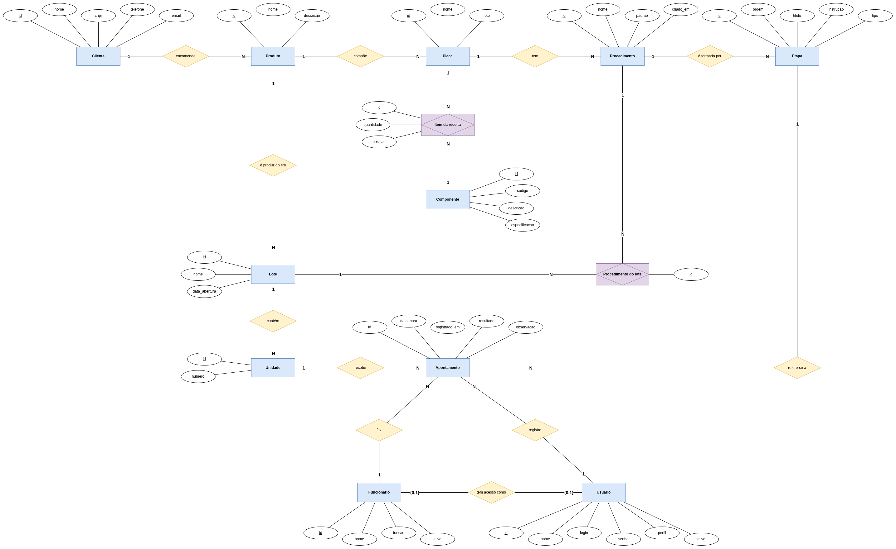

# Modelagem do Banco de Dados — IoT Production Manager

Projeto conceitual do banco de dados do IoT Production Manager: o negócio
que ele atende, as entidades, os atributos, os relacionamentos e as regras
que valem sobre eles.

---

## 1. Mini mundo

Uma equipe de produção monta e testa placas de circuito impresso (PCB) de
dispositivos IoT, encomendadas por empresas clientes. A equipe é administrada
por uma supervisora, que precisa acompanhar a produção sem depender de
planilhas nem da memória das pessoas.

Cada **cliente** encomenda um ou mais **produtos**. Um produto é composto por
uma ou mais **placas**: um sensor, por exemplo, pode ter uma placa principal e
uma placa de alimentação. Cada placa tem a sua receita de montagem, escrita e
mantida pela supervisora. A receita reúne a foto de referência da placa, os
**componentes** que ela leva, cada um registrado como um **item da receita**,
com a quantidade e a posição na placa (por exemplo, "C1 a C12"), e os
**procedimentos** de montagem. Os componentes formam um catálogo da equipe: o
mesmo capacitor pode ser usado em várias placas.

Uma placa pode ser montada de mais de um jeito, e por isso tem um ou mais
procedimentos: o padrão e as variações que a supervisora cria, como "Com
botão", "Com sensor de chama" ou "retrabalho". Cada procedimento é formado
por **etapas**,
numeradas na ordem recomendada de execução. Um procedimento que já foi usado
na produção não é alterado: para mudar o jeito de montar, a supervisora cria
um procedimento novo, e o histórico continua apontando para o antigo.

A produção acontece em **lotes**. Um lote é uma ordem de produção de um
produto, aberta numa data, com um nome escolhido pela supervisora e um número
de **unidades**. Ao abrir o lote, a supervisora define qual procedimento cada
placa do produto vai seguir, o padrão ou uma variação. Essa escolha fica
registrada como o **procedimento do lote**, e assim dois lotes do mesmo
produto podem seguir procedimentos diferentes ao mesmo tempo. Cada unidade é
uma peça física do produto, numerada dentro do lote, e é montada aos poucos,
por várias pessoas.

O trabalho feito em cada unidade é registrado em **apontamentos**. Um
apontamento diz qual **funcionário** fez qual etapa, de qual placa, em qual
unidade, e quando. O apontamento é de montagem ou de teste. No teste, ele
registra também o resultado, aprovado ou reprovado, e uma observação. Quando
uma unidade é reprovada, ela volta para a bancada, e o retrabalho é
registrado com apontamentos nas etapas de outro procedimento da placa, como o
de retrabalho, até um novo teste aprovado. Assim, quando um defeito aparece
semanas depois, é possível saber quem montou exatamente aquela parte da placa
e quem a corrigiu.

Os funcionários montam e testam, mas não acessam o sistema: quem registra os
apontamentos é a supervisora. O acesso é feito por **usuários**, cada um com
um perfil: a supervisora administra tudo, e o dono só consulta a produção. O
cadastro de funcionários e o de usuários são separados, para que um
funcionário possa ganhar acesso no futuro sem mudar o modelo.

### Objetivos do negócio

O banco de dados existe para a supervisora responder, a qualquer momento:

1. **Quanto falta?** Quantas unidades de um lote ainda não estão prontas, e
   quais etapas do procedimento do lote faltam em cada uma.
2. **Quem fez?** Qual funcionário montou, testou e corrigiu cada etapa de cada
   unidade, e com qual resultado.
3. **Como se faz?** Quais componentes, em que quantidade, e quais etapas de
   cada procedimento compõem a montagem de cada placa.
4. **Quanto material?** Quantos componentes de cada tipo um lote vai
   consumir, segundo a receita das suas placas.

---

## 2. Entidades

Cada entidade guarda um tipo de informação de que o negócio precisa. A tabela
lista as treze, na ordem em que aparecem no mini mundo, com o motivo de cada
uma existir.

| Entidade | Por que existe |
| :--- | :--- |
| **Cliente** | A empresa que encomenda os produtos. Existe para agrupar os produtos por quem os encomenda e responder "o que produzimos para este cliente?". |
| **Produto** | O item que um cliente encomenda, como "Sensor-X v2". É o que os lotes produzem: cada lote é de um produto só. |
| **Placa** | Uma PCB que compõe um produto. Existe separada do Produto porque um produto pode ter mais de uma placa, cada uma com os seus componentes e procedimentos. É na placa que fica a receita de montagem. |
| **Componente** | Um componente eletrônico do catálogo da equipe, como um capacitor de 10 µF. Existe uma vez só, mesmo quando é usado em várias placas, para responder "em quais placas este componente é usado?" e calcular o consumo previsto de um lote. |
| **Item da receita** | Um componente que uma placa leva, com a quantidade e a posição na placa ("C1 a C12"). É uma entidade associativa entre Placa e Componente: a quantidade e a posição não pertencem nem à placa nem ao componente, mas aos dois juntos. |
| **Procedimento** | Um jeito de montar uma placa: o padrão ou uma variação, como "Com botão", "Com sensor de chama" ou "retrabalho". Existe porque uma placa pode ser montada de mais de um jeito, e porque um procedimento já usado não é alterado: mudar o jeito de montar cria um procedimento novo, e o histórico continua apontando para o antigo. |
| **Etapa** | Um passo numerado de um procedimento, como "soldar os capacitores". É a "parte" que o apontamento registra: a mesma etapa ensina quem monta e rastreia quem montou. |
| **Lote** | Uma ordem de produção de um produto, com nome, data e número de unidades. Existe para acompanhar a produção pedido a pedido e responder "quanto falta neste lote?". |
| **Unidade** | Uma peça física produzida dentro de um lote, numerada. Existe porque cada unidade tem a sua própria história: quem montou, quem testou, se foi reprovada e quem a corrigiu. |
| **Procedimento do lote** | O procedimento que cada placa do produto segue num lote. É uma entidade associativa entre Lote e Procedimento: permite que dois lotes do mesmo produto sigam procedimentos diferentes ao mesmo tempo, e define as etapas que contam para "quanto falta". |
| **Apontamento** | O registro de que um funcionário fez uma etapa numa unidade: se foi montagem ou teste, quando, e no teste o resultado. É uma entidade própria, e não campos na Unidade, porque uma unidade acumula vários apontamentos: várias pessoas, várias etapas, testes e retrabalho. Campos como "montador" e "testador" só guardariam uma pessoa em cada papel. |
| **Funcionário** | Quem monta e testa as placas. Existe para que cada apontamento diga quem fez o trabalho. Não acessa o sistema. |
| **Usuário** | Quem entra no sistema, com um perfil: supervisora ou dono. Existe separado do Funcionário porque quem administra o sistema não é, necessariamente, quem aparece nos apontamentos. Um funcionário pode ganhar acesso no futuro, ligado a um usuário, sem mudar o modelo. |

### Por que a receita não é uma entidade

A receita de uma placa (a foto, os componentes com as suas quantidades e os
procedimentos de montagem) já está distribuída entre Placa, Item da receita,
Procedimento e Etapa. Uma entidade Receita teria exatamente um registro por
placa e nenhum dado próprio, porque a foto pertence à placa. Por isso
"receita" é um conceito do negócio, usado no texto, e não uma entidade do
modelo.

---

## 3. Atributos e tipos

Cada entidade tem uma tabela com os seus atributos e o tipo de cada um. As
convenções:

* **Nomes** em minúsculas, sem acento, com `_` entre as palavras.
* **(PK)** marca a chave primária, e **(FK → Entidade)** marca a chave
  estrangeira, que aponta para a entidade indicada.
* **Atributos de lista fixa** (tipo, resultado, perfil) são texto; os valores
  aceitos estão no dicionário de dados.
* **Nada que pode ser calculado é guardado**: o número de unidades de um lote
  é a contagem das suas unidades, o estado de uma unidade sai dos seus
  apontamentos, e o consumo de componentes sai dos itens da receita.

### Cliente

| Atributo | Tipo |
| :--- | :--- |
| `id` **(PK)** | `INTEGER` |
| `nome` | `VARCHAR(100)` |
| `cnpj` | `VARCHAR(14)` |
| `telefone` | `VARCHAR(20)` |
| `email` | `VARCHAR(100)` |

### Produto

| Atributo | Tipo |
| :--- | :--- |
| `id` **(PK)** | `INTEGER` |
| `cliente_id` **(FK → Cliente)** | `INTEGER` |
| `nome` | `VARCHAR(100)` |
| `descricao` | `TEXT` |

### Placa

| Atributo | Tipo |
| :--- | :--- |
| `id` **(PK)** | `INTEGER` |
| `produto_id` **(FK → Produto)** | `INTEGER` |
| `nome` | `VARCHAR(100)` |
| `foto` | `VARCHAR(255)` |

### Componente

| Atributo | Tipo |
| :--- | :--- |
| `id` **(PK)** | `INTEGER` |
| `codigo` | `VARCHAR(50)` |
| `descricao` | `VARCHAR(200)` |
| `especificacao` | `VARCHAR(100)` |

### Item da receita

| Atributo | Tipo |
| :--- | :--- |
| `id` **(PK)** | `INTEGER` |
| `placa_id` **(FK → Placa)** | `INTEGER` |
| `componente_id` **(FK → Componente)** | `INTEGER` |
| `quantidade` | `INTEGER` |
| `posicao` | `VARCHAR(100)` |

### Procedimento

| Atributo | Tipo |
| :--- | :--- |
| `id` **(PK)** | `INTEGER` |
| `placa_id` **(FK → Placa)** | `INTEGER` |
| `nome` | `VARCHAR(100)` |
| `padrao` | `BOOLEAN` |
| `criado_em` | `TIMESTAMP` |

### Etapa

| Atributo | Tipo |
| :--- | :--- |
| `id` **(PK)** | `INTEGER` |
| `procedimento_id` **(FK → Procedimento)** | `INTEGER` |
| `ordem` | `INTEGER` |
| `titulo` | `VARCHAR(100)` |
| `instrucao` | `TEXT` |
| `tipo` | `VARCHAR(20)` |

### Lote

| Atributo | Tipo |
| :--- | :--- |
| `id` **(PK)** | `INTEGER` |
| `produto_id` **(FK → Produto)** | `INTEGER` |
| `nome` | `VARCHAR(100)` |
| `data_abertura` | `DATE` |

### Unidade

| Atributo | Tipo |
| :--- | :--- |
| `id` **(PK)** | `INTEGER` |
| `lote_id` **(FK → Lote)** | `INTEGER` |
| `numero` | `INTEGER` |

### Procedimento do lote

| Atributo | Tipo |
| :--- | :--- |
| `id` **(PK)** | `INTEGER` |
| `lote_id` **(FK → Lote)** | `INTEGER` |
| `procedimento_id` **(FK → Procedimento)** | `INTEGER` |

### Apontamento

| Atributo | Tipo |
| :--- | :--- |
| `id` **(PK)** | `INTEGER` |
| `unidade_id` **(FK → Unidade)** | `INTEGER` |
| `etapa_id` **(FK → Etapa)** | `INTEGER` |
| `funcionario_id` **(FK → Funcionário)** | `INTEGER` |
| `usuario_id` **(FK → Usuário)** | `INTEGER` |
| `data_hora` | `TIMESTAMP` |
| `registrado_em` | `TIMESTAMP` |
| `resultado` | `VARCHAR(20)` |
| `observacao` | `TEXT` |

### Funcionário

| Atributo | Tipo |
| :--- | :--- |
| `id` **(PK)** | `INTEGER` |
| `usuario_id` **(FK → Usuário)** | `INTEGER` |
| `nome` | `VARCHAR(100)` |
| `funcao` | `VARCHAR(50)` |
| `ativo` | `BOOLEAN` |

### Usuário

| Atributo | Tipo |
| :--- | :--- |
| `id` **(PK)** | `INTEGER` |
| `nome` | `VARCHAR(100)` |
| `login` | `VARCHAR(50)` |
| `senha` | `VARCHAR(128)` |
| `perfil` | `VARCHAR(20)` |
| `ativo` | `BOOLEAN` |

---

## 4. Chaves primárias

Toda entidade é identificada por um `id`: um número inteiro que o banco gera
sozinho, em sequência, quando o registro é criado, e que nunca muda. É uma
chave artificial: não vem do negócio e existe só para identificar o
registro.

### Por que uma chave artificial

Alguns dados do negócio poderiam identificar um registro, como o CNPJ de um
cliente ou o código de um componente. Eles não servem como chave primária
por três motivos:

* **Podem mudar.** Um código de componente pode ser renomeado, e um login
  pode ser trocado. A chave primária é copiada nas chaves estrangeiras das
  outras tabelas; se ela mudasse, todas as cópias teriam de mudar junto.
* **Podem faltar.** O CNPJ de um cliente pode não estar à mão no primeiro
  cadastro, e uma chave primária nunca pode ficar vazia.
* **Muitas entidades não têm nenhum.** O nome de um lote é livre, o número
  de uma unidade se repete em todos os lotes, e um apontamento não tem
  nenhuma combinação de dados que seja única.

Um inteiro gerado pelo banco não tem nenhum desses problemas, ocupa pouco
espaço e deixa as ligações entre as tabelas mais rápidas. Os dados do
negócio que não podem se repetir continuam protegidos, como atributos
únicos.

| Entidade | Chave primária | Motivo |
| :--- | :--- | :--- |
| **Cliente** | `id` | O CNPJ identifica a empresa, mas pode faltar no primeiro cadastro. Fica como atributo único. |
| **Produto** | `id` | O nome não identifica: clientes diferentes podem ter produtos com o mesmo nome. |
| **Placa** | `id` | O nome se repete entre produtos: quase todo produto tem uma "Placa principal". |
| **Componente** | `id` | O código pode ser renomeado. Fica como atributo único. |
| **Item da receita** | `id` | A combinação placa + componente não se repete, e fica como atributo único. O `id` mantém a mesma regra em todas as entidades. |
| **Procedimento** | `id` | O nome se repete entre placas: quase toda placa tem um procedimento "Padrão". |
| **Etapa** | `id` | O número de ordem só é único dentro do procedimento. A combinação procedimento + ordem fica como atributo único. |
| **Lote** | `id` | O nome é livre, escolhido pela supervisora, e pode se repetir. |
| **Unidade** | `id` | O número só é único dentro do lote: toda unidade 7 de todos os lotes tem o número 7. A combinação lote + número fica como atributo único. |
| **Procedimento do lote** | `id` | A combinação lote + procedimento não se repete, e fica como atributo único. O `id` mantém a mesma regra em todas as entidades. |
| **Apontamento** | `id` | Nenhuma combinação de atributos é única: a mesma pessoa pode registrar a mesma etapa, na mesma unidade, mais de uma vez, como num novo teste depois de um retrabalho. |
| **Funcionário** | `id` | Nomes se repetem, e o funcionário não tem um documento obrigatório no sistema. |
| **Usuário** | `id` | O login pode ser trocado. Fica como atributo único. |

### Atributos únicos que não são chave

Estes atributos, sozinhos ou combinados, não podem se repetir. O banco
recusa um registro que repita algum deles.

| Entidade | Atributo(s) únicos | O que garante |
| :--- | :--- | :--- |
| **Cliente** | `cnpj` | Dois clientes não têm o mesmo CNPJ. |
| **Componente** | `codigo` | O mesmo componente não é cadastrado duas vezes no catálogo. |
| **Usuário** | `login` | Duas pessoas não entram no sistema com o mesmo login. |
| **Item da receita** | `placa_id` + `componente_id` | Um componente aparece uma vez só na receita de uma placa; a quantidade diz quantos ela leva. |
| **Etapa** | `procedimento_id` + `ordem` | Duas etapas do mesmo procedimento não têm o mesmo número. |
| **Unidade** | `lote_id` + `numero` | A numeração das unidades não se repete dentro de um lote. |
| **Procedimento do lote** | `lote_id` + `procedimento_id` | O mesmo procedimento não é escolhido duas vezes para o mesmo lote. |
| **Funcionário** | `usuario_id` | Um usuário fica ligado a no máximo um funcionário. Vale só quando o atributo está preenchido. |

---

## 5. Relacionamentos

| Relacionamento | Entidades | Cardinalidade | Por que existe |
| :--- | :--- | :---: | :--- |
| **encomenda** | Cliente → Produto | 1:N | Um cliente encomenda vários produtos, e cada produto é de um cliente só. Responde "o que produzimos para este cliente?". |
| **compõe** | Produto → Placa | 1:N | Um produto é composto por uma ou mais placas, e cada placa pertence a um produto. É na placa que fica a receita. |
| **tem** | Placa → Procedimento | 1:N | Uma placa pode ser montada de mais de um jeito; cada procedimento é de uma placa só. |
| **é formado por** | Procedimento → Etapa | 1:N | Um procedimento é a sequência das suas etapas, e cada etapa pertence a um procedimento. |
| **leva** | Placa → Componente, por meio do Item da receita | N:N | Uma placa leva vários componentes, e o mesmo componente é usado em várias placas. A quantidade e a posição na placa ficam no Item da receita. |
| **é produzido em** | Produto → Lote | 1:N | Um produto é produzido em vários lotes ao longo do tempo, e cada lote é de um produto só. |
| **contém** | Lote → Unidade | 1:N | Um lote contém as suas unidades, e cada unidade nasce num lote. |
| **segue** | Lote → Procedimento, por meio do Procedimento do lote | N:N | Um lote segue um procedimento para cada placa do produto, e o mesmo procedimento é seguido por vários lotes. Define as etapas que contam para "quanto falta". |
| **recebe** | Unidade → Apontamento | 1:N | Uma unidade recebe vários apontamentos ao longo da montagem, e cada apontamento é de uma unidade. |
| **refere-se a** | Apontamento → Etapa | N:1 | Cada apontamento registra uma etapa, e a mesma etapa é feita em muitas unidades. É "a parte" que alguém fez. |
| **faz** | Funcionário → Apontamento | 1:N | Um funcionário faz muitos apontamentos, e cada apontamento diz quem fez o trabalho. |
| **registra** | Usuário → Apontamento | 1:N | Um usuário registra muitos apontamentos, e cada apontamento guarda quem o registrou no sistema. |
| **tem acesso como** | Funcionário → Usuário | 1:1, opcional | Hoje nenhum funcionário tem acesso. Quando um ganhar, ele fica ligado a um usuário, e um usuário a no máximo um funcionário. Os dois lados são opcionais: a supervisora é usuário sem ser funcionário. |

### Diagrama de entidade e relacionamento

O DER abaixo mostra as 13 entidades, os seus atributos e os relacionamentos
da tabela, na notação de Chen: entidade em retângulo, relacionamento em
losango, entidade associativa em losango dentro de retângulo e atributo em
elipse, com a chave primária sublinhada. As chaves estrangeiras não aparecem
como atributos: no modelo conceitual, a ligação é o próprio relacionamento.
O arquivo editável é o [`der.drawio`](der.drawio).

---

## 6. Dicionário de dados

Para cada atributo: o tipo, o tamanho, a chave, se é obrigatório e o que
guarda. Na coluna **Chave**, `Único` marca os atributos que não podem se
repetir (seção 4). Na coluna **Obrigatório**, `Condicional` quer dizer que a
obrigação depende de outro dado, explicado na descrição. Os atributos de
lista fixa guardam códigos sem acento, e a descrição lista os valores
aceitos.

### Cliente

| Atributo | Tipo | Tamanho | Chave | Obrigatório | Descrição |
| :--- | :--- | :---: | :--- | :---: | :--- |
| `id` | `INTEGER` | — | PK | Sim | Identificador do cliente, gerado pelo banco. |
| `nome` | `VARCHAR` | 100 | — | Sim | Nome da empresa cliente. |
| `cnpj` | `VARCHAR` | 14 | Único | Não | CNPJ da empresa, só os 14 dígitos, sem pontos, barra ou traço. |
| `telefone` | `VARCHAR` | 20 | — | Não | Telefone de contato, com DDD. |
| `email` | `VARCHAR` | 100 | — | Não | E-mail de contato. |

### Produto

| Atributo | Tipo | Tamanho | Chave | Obrigatório | Descrição |
| :--- | :--- | :---: | :--- | :---: | :--- |
| `id` | `INTEGER` | — | PK | Sim | Identificador do produto, gerado pelo banco. |
| `cliente_id` | `INTEGER` | — | FK → Cliente | Sim | Cliente que encomenda o produto. |
| `nome` | `VARCHAR` | 100 | — | Sim | Nome do produto, como "Sensor-X v2". |
| `descricao` | `TEXT` | — | — | Não | Descrição livre do produto. |

### Placa

| Atributo | Tipo | Tamanho | Chave | Obrigatório | Descrição |
| :--- | :--- | :---: | :--- | :---: | :--- |
| `id` | `INTEGER` | — | PK | Sim | Identificador da placa, gerado pelo banco. |
| `produto_id` | `INTEGER` | — | FK → Produto | Sim | Produto que a placa compõe. |
| `nome` | `VARCHAR` | 100 | — | Sim | Nome da placa dentro do produto, como "Placa principal". |
| `foto` | `VARCHAR` | 255 | — | Não | Caminho do arquivo da foto de referência da placa. A imagem fica guardada fora do banco. |

### Componente

| Atributo | Tipo | Tamanho | Chave | Obrigatório | Descrição |
| :--- | :--- | :---: | :--- | :---: | :--- |
| `id` | `INTEGER` | — | PK | Sim | Identificador do componente, gerado pelo banco. |
| `codigo` | `VARCHAR` | 50 | Único | Sim | Código do componente no catálogo da equipe. |
| `descricao` | `VARCHAR` | 200 | — | Sim | O que é o componente, como "Resistor SMD 0603" ou "Display OLED I2C". |
| `especificacao` | `VARCHAR` | 100 | — | Não | O que distingue o componente de outros do mesmo tipo, como "10 kΩ", "100 nF 50 V" ou "0,96 pol. com faixa amarela". |

### Item da receita

| Atributo | Tipo | Tamanho | Chave | Obrigatório | Descrição |
| :--- | :--- | :---: | :--- | :---: | :--- |
| `id` | `INTEGER` | — | PK | Sim | Identificador do item, gerado pelo banco. |
| `placa_id` | `INTEGER` | — | FK → Placa, único com `componente_id` | Sim | Placa que leva o componente. |
| `componente_id` | `INTEGER` | — | FK → Componente, único com `placa_id` | Sim | Componente que a placa leva. |
| `quantidade` | `INTEGER` | — | — | Sim | Quantas unidades do componente a placa leva. Maior que zero. |
| `posicao` | `VARCHAR` | 100 | — | Não | Onde o componente vai na placa, pelas referências do esquema, como "C1 a C12". |

### Procedimento

| Atributo | Tipo | Tamanho | Chave | Obrigatório | Descrição |
| :--- | :--- | :---: | :--- | :---: | :--- |
| `id` | `INTEGER` | — | PK | Sim | Identificador do procedimento, gerado pelo banco. |
| `placa_id` | `INTEGER` | — | FK → Placa | Sim | Placa que o procedimento monta. |
| `nome` | `VARCHAR` | 100 | — | Sim | Nome do procedimento, como "Padrão", "Com botão" ou "Retrabalho". |
| `padrao` | `BOOLEAN` | — | — | Sim | Verdadeiro no procedimento que um lote novo recebe quando a supervisora não escolhe outro. |
| `criado_em` | `TIMESTAMP` | — | — | Sim | Data e hora em que o procedimento foi criado, preenchidas pelo sistema. |

### Etapa

| Atributo | Tipo | Tamanho | Chave | Obrigatório | Descrição |
| :--- | :--- | :---: | :--- | :---: | :--- |
| `id` | `INTEGER` | — | PK | Sim | Identificador da etapa, gerado pelo banco. |
| `procedimento_id` | `INTEGER` | — | FK → Procedimento, único com `ordem` | Sim | Procedimento a que a etapa pertence. |
| `ordem` | `INTEGER` | — | Único com `procedimento_id` | Sim | Posição da etapa na ordem recomendada de execução, a partir de 1. |
| `titulo` | `VARCHAR` | 100 | — | Sim | O que a etapa faz, em poucas palavras, como "Soldar os capacitores". |
| `instrucao` | `TEXT` | — | — | Não | Como fazer a etapa, em detalhe: cuidados, ferramentas, o que conferir. |
| `tipo` | `VARCHAR` | 20 | — | Sim | `montagem` ou `teste`. Define se o apontamento da etapa leva resultado. |

### Lote

| Atributo | Tipo | Tamanho | Chave | Obrigatório | Descrição |
| :--- | :--- | :---: | :--- | :---: | :--- |
| `id` | `INTEGER` | — | PK | Sim | Identificador do lote, gerado pelo banco. |
| `produto_id` | `INTEGER` | — | FK → Produto | Sim | Produto que o lote produz. |
| `nome` | `VARCHAR` | 100 | — | Sim | Nome do lote, escolhido pela supervisora. |
| `data_abertura` | `DATE` | — | — | Sim | Data em que o lote foi aberto. |

### Unidade

| Atributo | Tipo | Tamanho | Chave | Obrigatório | Descrição |
| :--- | :--- | :---: | :--- | :---: | :--- |
| `id` | `INTEGER` | — | PK | Sim | Identificador da unidade, gerado pelo banco. |
| `lote_id` | `INTEGER` | — | FK → Lote, único com `numero` | Sim | Lote em que a unidade é produzida. |
| `numero` | `INTEGER` | — | Único com `lote_id` | Sim | Número da unidade dentro do lote, de 1 até o número de unidades. |

### Procedimento do lote

| Atributo | Tipo | Tamanho | Chave | Obrigatório | Descrição |
| :--- | :--- | :---: | :--- | :---: | :--- |
| `id` | `INTEGER` | — | PK | Sim | Identificador da escolha, gerado pelo banco. |
| `lote_id` | `INTEGER` | — | FK → Lote, único com `procedimento_id` | Sim | Lote que segue o procedimento. |
| `procedimento_id` | `INTEGER` | — | FK → Procedimento, único com `lote_id` | Sim | Procedimento que uma das placas do produto segue nesse lote. |

### Apontamento

| Atributo | Tipo | Tamanho | Chave | Obrigatório | Descrição |
| :--- | :--- | :---: | :--- | :---: | :--- |
| `id` | `INTEGER` | — | PK | Sim | Identificador do apontamento, gerado pelo banco. |
| `unidade_id` | `INTEGER` | — | FK → Unidade | Sim | Unidade em que o trabalho foi feito. |
| `etapa_id` | `INTEGER` | — | FK → Etapa | Sim | Etapa que foi feita. O tipo da etapa diz se o apontamento é de montagem ou de teste. |
| `funcionario_id` | `INTEGER` | — | FK → Funcionário | Sim | Funcionário que fez o trabalho. |
| `usuario_id` | `INTEGER` | — | FK → Usuário | Sim | Usuário que registrou o apontamento no sistema. |
| `data_hora` | `TIMESTAMP` | — | — | Sim | Data e hora em que o trabalho foi feito. |
| `registrado_em` | `TIMESTAMP` | — | — | Sim | Data e hora em que o apontamento foi registrado, preenchidas pelo sistema. |
| `resultado` | `VARCHAR` | 20 | — | Condicional | `aprovado` ou `reprovado`. Obrigatório quando a etapa é de teste, vazio quando é de montagem. |
| `observacao` | `TEXT` | — | — | Não | Comentário livre, como o defeito encontrado num teste reprovado ou o que foi feito num retrabalho. |

### Funcionário

| Atributo | Tipo | Tamanho | Chave | Obrigatório | Descrição |
| :--- | :--- | :---: | :--- | :---: | :--- |
| `id` | `INTEGER` | — | PK | Sim | Identificador do funcionário, gerado pelo banco. |
| `usuario_id` | `INTEGER` | — | FK → Usuário, único | Não | Usuário do funcionário, quando ele tem acesso ao sistema. |
| `nome` | `VARCHAR` | 100 | — | Sim | Nome do funcionário. |
| `funcao` | `VARCHAR` | 50 | — | Não | Função na equipe, como "montador" ou "técnico de teste". |
| `ativo` | `BOOLEAN` | — | — | Sim | Falso para quem saiu da equipe. O funcionário inativo continua nos apontamentos antigos. |

### Usuário

| Atributo | Tipo | Tamanho | Chave | Obrigatório | Descrição |
| :--- | :--- | :---: | :--- | :---: | :--- |
| `id` | `INTEGER` | — | PK | Sim | Identificador do usuário, gerado pelo banco. |
| `nome` | `VARCHAR` | 100 | — | Sim | Nome de quem usa o sistema. |
| `login` | `VARCHAR` | 50 | Único | Sim | Nome usado para entrar no sistema. |
| `senha` | `VARCHAR` | 128 | — | Sim | Senha cifrada. O banco nunca guarda a senha como foi digitada. |
| `perfil` | `VARCHAR` | 20 | — | Sim | `supervisora`, `dono` ou `tecnico`. Define o que o usuário pode fazer. |
| `ativo` | `BOOLEAN` | — | — | Sim | Falso para quem perdeu o acesso. O usuário inativo continua nos registros antigos. |

---

## 7. Regras de negócio

Regras seguindo a ordem do mini mundo: a receita, a produção, os
apontamentos, as consultas e o acesso.

| Regra de Negócio | Descrição |
| :--- | :--- |
| **RN01 — Componente único na receita** | Um componente aparece no máximo uma vez na receita de uma placa. Se a placa leva doze capacitores iguais, é um item da receita com quantidade 12. |
| **RN02 — Ordem das etapas** | As etapas de um procedimento são numeradas em sequência, sem repetir o número. A ordem é a recomendada, não a obrigatória: os apontamentos são aceitos em qualquer ordem, e duas pessoas podem trabalhar ao mesmo tempo em etapas diferentes da mesma unidade. |
| **RN03 — Um procedimento padrão por placa** | Cada placa tem exatamente um procedimento padrão. Marcar outro procedimento como padrão desmarca o anterior. |
| **RN04 — Procedimento usado não muda** | Um procedimento escolhido em algum lote não tem o nome nem as etapas alterados, e nem ele nem as suas etapas são apagados. Para mudar o jeito de montar, a supervisora cria um procedimento novo. Só o atributo `padrao` pode mudar, porque ele vale para os lotes novos, não para o que já foi feito. |
| **RN05 — Procedimento de cada placa no lote** | Ao abrir um lote, cada placa do produto recebe exatamente um procedimento, sempre um procedimento daquela placa. Se a supervisora não escolher outro, é o padrão. |
| **RN06 — Unidades do lote** | Ao abrir um lote, a supervisora informa quantas unidades ele tem, e o sistema cria as unidades numeradas de 1 até esse número. O número de unidades de um lote é a contagem das suas unidades. |
| **RN07 — Lote de um produto só** | Todas as unidades de um lote são do produto do lote, e todas têm as mesmas placas: as do produto. |
| **RN08 — Etapa do apontamento** | Um apontamento só registra uma etapa de um procedimento de uma placa do produto daquele lote. Se a etapa é de um procedimento escolhido no lote, é trabalho normal. Se é de outro procedimento da mesma placa, é retrabalho. |
| **RN09 — Resultado do teste** | Um apontamento numa etapa de teste tem resultado, `aprovado` ou `reprovado`. Um apontamento numa etapa de montagem não tem resultado. |
| **RN10 — Funcionário ativo** | Só um funcionário ativo recebe apontamentos novos. Os apontamentos antigos de um funcionário que ficou inativo continuam como estão. |
| **RN11 — Registro automático** | Ao registrar um apontamento, o sistema preenche quem registrou (`usuario_id`, o usuário que está no sistema) e quando (`registrado_em`, o momento do registro). A data e a hora do trabalho (`data_hora`) são informadas por quem registra. |
| **RN12 — Unidade pronta** | Uma unidade está pronta quando, em cada procedimento escolhido no seu lote: cada etapa de montagem tem pelo menos um apontamento; e cada etapa de teste tem apontamento, e o mais recente (pela `data_hora`) está aprovado. Um teste reprovado tira a unidade de "pronta" até um novo teste aprovado. Etapas de retrabalho (de outros procedimentos da placa) não contam para essa conta. |
| **RN13 — Consumo previsto** | O consumo previsto de um componente num lote é a soma das quantidades dele nos itens da receita de todas as placas do produto, multiplicada pelo número de unidades do lote. Exemplo: se a placa principal leva 12 capacitores C e a de alimentação leva 4, um lote de 50 unidades consome (12 + 4) × 50 = 800. É o previsto pela receita: perdas e retrabalho não entram na conta. |
| **RN14 — Acesso da supervisora** | A supervisora faz tudo: cadastra clientes, produtos, placas, componentes, receitas e procedimentos, abre lotes, registra apontamentos e consulta a produção. |
| **RN15 — Acesso do dono** | O dono só consulta: vê a produção, os lotes e os apontamentos, mas não cadastra nem altera nada. |
| **RN16 — Acesso do técnico** | O técnico, quando existir, só registra apontamentos (montagem e teste) e consulta o que precisa para isso. Ele não altera cadastros, receitas, procedimentos nem componentes. |
| **RN17 — Usuário ativo** | Só um usuário ativo entra no sistema. Os registros feitos por um usuário que ficou inativo continuam como estão. |
| **RN18 — Histórico preservado** | Nada que um apontamento referencia é apagado: unidade, etapa, funcionário e usuário. Funcionários e usuários que saem são desativados, e procedimentos usados seguem a RN04. Assim todo apontamento continua dizendo quem fez o quê, em qual unidade. |
